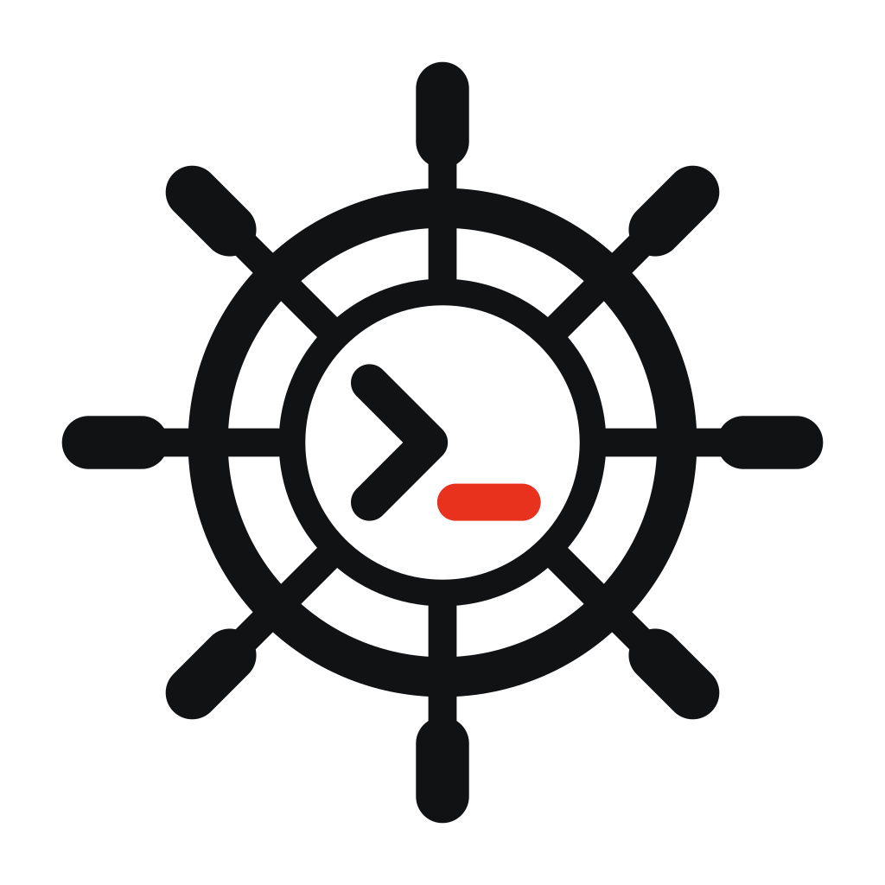

<p align="center">
  <picture>
    <source media="(prefers-color-scheme: dark)" srcset="assets/logo/styrman-glyph-light.svg">
    
  </picture>
</p>

<h1 align="center">Styrman</h1>

<p align="center"><b>Steer your coding agents from anywhere.</b></p>

<p align="center">
  A personal remote control for Claude Code, Antigravity CLI and Codex CLI:<br>
  type <code>/styr</code> in a running session and follow, approve and prompt it from your iPhone.
</p>

---

## Why Styrman

Coding agents now run for minutes, sometimes hours, but they still need you at odd moments: to approve a command, to answer a question, or to hear "done, what next?". If you step away from the terminal, the agent sits idle at a permission prompt, or it finishes and waits for nobody.

The agents' own answers to this don't fit how I work:

- **Each one has its own remote.** Claude Code has Remote Control, and Antigravity has its own web remote. Each covers only its own agent, needs its own app or tab, and goes through the vendor's cloud. When three different agents run side by side in different repos, there is no single place to see which one needs me.
- **Prompts block the whole session.** A Claude session waiting on "Allow `cargo test`?" makes no progress until someone presses a key in that terminal.
- **I want it to be mine.** No relay service, no account, nothing leaving my machines except the push notification itself. It stays on my Mac and my tailnet.

Styrman (Swedish/Norwegian *styrmann*, "helmsman") is one helm for all of them. Your terminal workflow doesn't change. Sessions stay invisible until you type `/styr` in one; from then on, that session appears on your phone with its live conversation, tool calls, permission cards (Allow once / Always / Deny) and a prompt box, and you get a notification when it needs you or is done.

## How it works

```
 terminal                         your Mac                               iPhone
┌───────────────┐  hooks   ┌──────────────┐   WebSocket over   ┌──────────────────┐
│ claude / agy  │ ───────► │              │   Tailscale only   │  Styrman (iOS)   │
│ / codex       │ ◄─────── │    styrd     │ ◄────────────────► │  sessions, chat, │
└───────────────┘  answers │  (launchd)   │                    │  approvals,      │
        ▲                  │   SQLite     │ ──── APNs push ──► │  prompt box      │
        │ styr claude …    └──────────────┘                    └──────────────────┘
        └── styr: launcher + `styr hook` helper (fails open if styrd is down)
```

- **`styrd`** is a Rust daemon (tokio) on your Mac. It tracks sessions, keeps their history in SQLite, and serves a token-authenticated WebSocket API on localhost and your Tailscale address only.
- **`styr`** is a small Rust CLI. It launches agents (`alias claude='styr claude'`) and is the helper their hooks call (`styr hook <event>`). If the daemon isn't running, it does nothing, and the agent behaves exactly as it would without Styrman.
- **Adapters** turn each agent's own signals into one common event model:
  - **Claude Code** (first): hooks and a `styrman` plugin
  - **Antigravity `agy`** (second): hooks, a plugin and ACP
  - **Codex** (third): attaches to `codex app-server` as a second client
  - **PTY**: a generic fallback for agents with no hooks or protocol
- **The iOS app** is SwiftUI. It pairs by scanning a QR code from `styr pair`, and gets "needs approval" and "done" notifications via APNs.

Design details and the reasoning behind them are in [`docs/design.md`](docs/design.md).

## Status

| Checkpoint | State |
|---|---|
| 1. Daemon, Unix socket, SQLite, `styr status` | ✅ done |
| 2. `styr hook` plus the Claude plugin (mirroring only) and the fake-agent test harness | ✅ done |
| 3. iOS app: pairing and live sessions (read-only) | ✅ done |
| 4. Permission round-trip | ✅ done |
| 5. Prompts from the phone | ✅ done |
| 6. Push notifications | next |
| 7. Pairing and auth hardening, launchd, install docs | |

## Try it (checkpoint 2)

Install the binaries, start the daemon, and add the Claude Code plugin:

```sh
cargo install --path crates/styrd
cargo install --path crates/styr          # puts styr on PATH (~/.cargo/bin)
styrd &                                   # launchd setup comes in checkpoint 7

claude plugin marketplace add "$PWD/plugins"
claude plugin install styrman@styrman
```

Then, in any Claude Code session:

```
/styr        share this session (handled by a hook: no model call, nothing sent to Claude)
/styr off    stop sharing
```

From the terminal:

```sh
styr status            # shared sessions: working / needs approval / needs you / done
styr status --all      # include sessions that were never shared
styr events <ID>       # full mirrored history of one session
```

Optional: `alias claude='styr claude'` (likewise `agy`, `codex`). This runs the next `claude` on your PATH (wrappers such as cmux's stay in the chain) and tags the session as started through Styrman. The plugin works without the alias.

**Fail-open guarantee.** Every hook goes through `styr hook`. It always exits 0, and prints nothing unless the daemon has an answer. If `styrd` isn't running, or `styr` isn't installed at all, Claude Code behaves exactly as it would without Styrman.

**Privacy.** Until you type `/styr`, Styrman keeps only a session's start and end (for `styr status --all`). Your prompts, Claude's replies and tool calls are not stored, and nothing about the session is visible to the phone.

### Approving from the phone

When a shared session needs permission, the phone shows a card with **Allow once**, **Always allow** (when Claude offers a "don't ask again" rule), and **Deny**. Claude Code shows its own prompt in the terminal at the same time, and whichever answer comes first wins. Answering at the keyboard closes the card on the phone, and answering on the phone dismisses the terminal prompt. Nothing is ever approved automatically.

The phone can answer for 9 minutes; set `STYR_PERMISSION_TIMEOUT` (seconds) on `styrd` to change that. Unshared sessions never wait.

If your Claude Code runs in `auto` permission mode, it approves routine actions itself, so cards only appear for the actions it would ask you about.

### Prompts from the phone

Type in the message box at the bottom of a session.

- **Claude is idle:** it wakes up and answers within a couple of seconds.
- **Claude is working:** the message is queued and sent the moment Claude finishes, and the phone shows it as queued until then.
- **Typing in the terminal still works:** whatever you type there takes priority, and the phone's pending wait steps aside.
- **From the Mac:** `styr send <ID> <text>` does the same, for scripts.

This uses a second, background `Stop` hook in the plugin (`async` + `asyncRewake`). It waits for a phone message and, when one arrives, exits with code 2 to wake Claude. In the terminal, the message appears as "Stop hook feedback".

### The iPhone app

```sh
cd ios && xcodegen            # regenerate Styrman.xcodeproj after changing project.yml
open Styrman.xcodeproj        # run on your iPhone (team 7R6QL53THM is preset)
styr pair                     # on the Mac: shows a QR code; scan it with the iPhone camera
styr devices                  # list paired phones; `styr devices revoke <ID>` unpairs one
```

The phone reaches `styrd` over Tailscale only. Have Tailscale running on both the Mac and the iPhone.

- The daemon binds to loopback and the Mac's Tailscale addresses on port 4719 (`STYR_PORT`), never to `0.0.0.0`. `STYR_TAILSCALE=0` restricts it to loopback.
- Pairing links use the Mac's MagicDNS name (`*.ts.net`). iOS only lets the app make unencrypted connections to `ts.net` hosts, and Tailscale's WireGuard tunnel already encrypts that traffic.
- The QR code holds a one-time code that expires after 5 minutes. Redeeming it gives the phone a device token, which is stored in the iOS Keychain and sent only in the `Authorization` header.

### Developing

```sh
cargo test --workspace                          # unit + end-to-end tests (real styr binary, in-process styrd)
cargo run -p styr-testkit --bin styr-fake-agent  # demo session; pauses at a permission until you answer on the phone
cargo run -p styr-testkit --bin styr-fake-phone  # a scripted phone that answers the next permission request
STYR_HOOK_RECORD=/tmp/hooks.jsonl claude …       # record raw hook payloads as fixtures
```

Environment: `STYR_HOME` (data directory), `STYR_SOCKET` (socket path; macOS caps it at 103 bytes), `STYR_BIN` (which `styr` the plugin calls), `STYR_LOG` (daemon log filter, e.g. `debug`), `STYR_DEBUG` (make `styr hook` report errors on stderr).

## Repository layout

```
crates/styr-core          event model, status reducer, adapter trait, IPC types
crates/styrd              the daemon
crates/styr               the CLI (launcher, hook helper, status)
crates/styr-testkit       fake-agent harness + styr-fake-agent
crates/adapters/*         claude (working); agy, codex, pty (stubs)
plugins/                  Claude Code plugin + local marketplace
assets/logo               icon and logo concepts
docs/design.md     architecture and protocol notes
```
