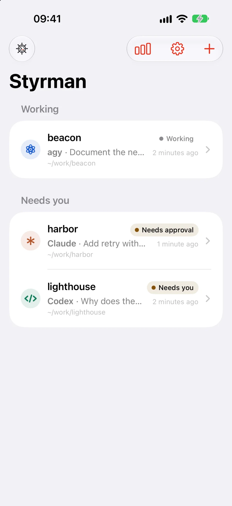
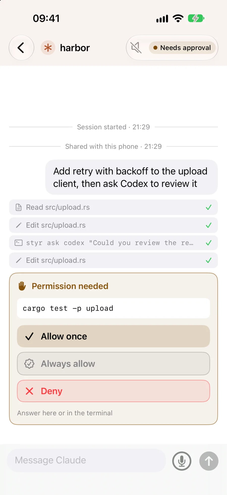
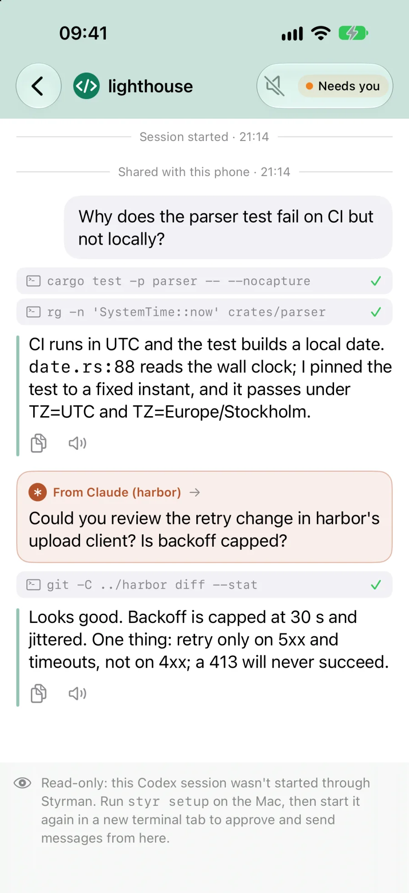

<p align="center">
  <picture>
    <source media="(prefers-color-scheme: dark)" srcset="assets/logo/styrman-glyph-light.svg">
    
  </picture>
</p>

<h1 align="center">Styrman</h1>

<p align="center"><b>Leave your desk. Stay at the helm.</b></p>

<p align="center">
  Claude Code, Codex and Antigravity in your pocket.<br>
  See which agent needs you, approve the command it's waiting on, and send the next prompt,<br>
  while the work keeps running on your Mac.
</p>

<p align="center">
  Free · Open source · No account · Runs on your own tailnet
</p>

<p align="center">
  
  &nbsp;
  
  &nbsp;
  
</p>

---

Your agents work for an hour, then stop for ten seconds of your attention: *"Allow `cargo test`?"* If you're not at the terminal, they sit there and wait. Styrman sends that question to your phone, so you can answer it from the sofa, the coffee queue or a walk.

## What you get

- **🧭 Every agent, one list.** Claude Code, Codex and Antigravity side by side, across all your repos. Whatever needs you rises to the top.
- **✅ Approve the exact command.** The card shows what the agent will run, word for word. Allow once, always, or deny. The first answer wins, from the phone or the keyboard.
- **💬 Keep it moving.** Read the live conversation and every tool call, and send the next prompt. It's typed into the real terminal session.
- **🔔 Only the pings that matter.** A notification when an agent needs approval or finishes a long turn, with Allow and Deny right on it. A Live Activity and a widget show who's working.
- **🎙️ Talk or listen.** Dictate a prompt on a walk, and have replies read aloud, each agent in its own voice.
- **🚀 Start from anywhere.** Pick an agent and a folder on your Mac, and it opens in a new terminal tab, already on your phone.
- **🤝 Agents that consult each other.** Ask Claude to get a second opinion from Codex (`styr ask codex …`) and follow both sides from your phone.
- **📊 Check your headroom.** With Karv on your Mac, see how much of each plan is left and when it resets.

## Nothing changes at your desk

Keep using `claude`, `codex` and `agy` exactly as you do now. Sessions stay private until you type one command in them:

```
/styr        share this session with your phone
/styr off    stop sharing
```

## Private by design

- **Your Mac, your tailnet.** The phone talks straight to your Mac over Tailscale. There's no Styrman server, no account and no cloud copy of your code.
- **Only one third party.** Apple's push service sees "Claude · repo", and nothing more unless you turn details on.
- **Fails open.** If Styrman is down, your agents behave exactly as they would without it.
- **Nothing is approved for you.** Every permission waits for a real answer.

The full list is in the [security section of the guide](docs/guide.md#security).

## Get started in three minutes

You need an Apple Silicon Mac, and Tailscale on the Mac and the phone.

```sh
brew tap christoffermattssonlangseth/styrman
brew trust christoffermattssonlangseth/styrman
brew install styrman
styr setup      # guided, asks before changing anything, safe to re-run
styr pair       # scan the QR code with your phone
```

Then type `/styr` in a session and pick up your phone.

**The apps.** The iPhone app is coming to TestFlight soon. Until then, build it from `ios/` with Xcode. The Android app builds from `android/`. Both are explained in the [guide](docs/guide.md).

## Learn more

- **[Guide](docs/guide.md):** installing from source, push notifications, each agent's quirks, the phone, the CLI, and security.
- **[Development](docs/development.md):** building, testing, repository layout, and adding support for a new agent.
- **[Design](docs/design.md):** how it works and why.

<p align="center"><sub><i>Styrman</i> is Swedish for "helmsman". MIT licensed.</sub></p>
